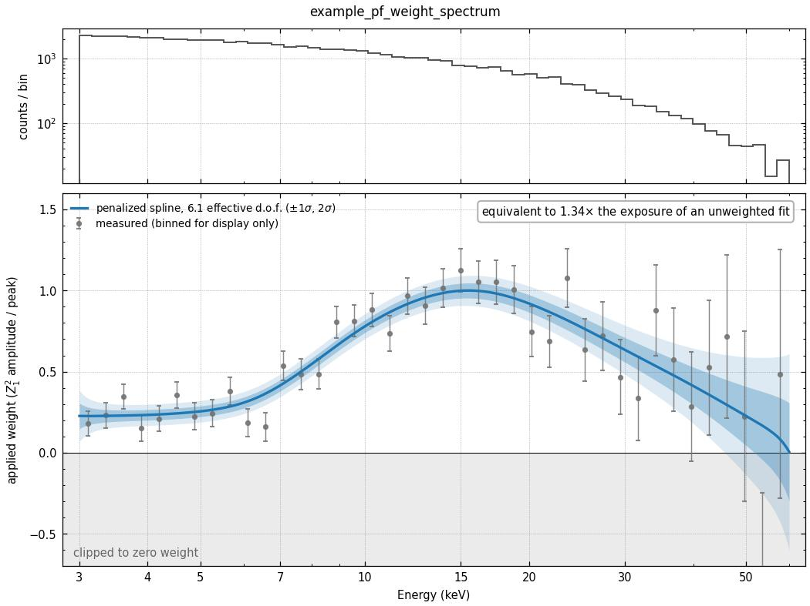
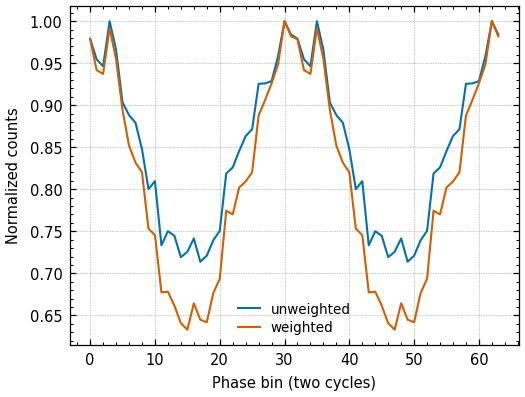

Energy weighting
================

The pulsed fraction of an X-ray pulsar is rarely the same at all energies. It
usually rises with energy and then turns over, and lines and edges carve
features into it. A photon from a band where the pulse is strong tells you more
about the pulse phase than one from a band where it is weak. ``--use-weight``
exploits this by giving each event a weight that follows the pulsed fraction at
its energy.

This page explains how those weights are measured, how they enter the fit, what
they are worth, and how to read the two diagnostic figures every weighted run
writes. The code is in :mod:`ell1fit.weighting`, and it is called from stage 2
of the :doc:`pipeline`.

What a weight should be
-----------------------

Write :math:`a(E)` for the pulsed amplitude at energy :math:`E`: the depth of
the modulation of the photons at that energy. The timing information a photon
carries goes as :math:`a(E)^2`, and the weights that extract all of it are
proportional to :math:`a(E)` itself. A weighted statistic built from weights
:math:`w_i` captures a fraction

.. math::

   \eta = \frac{\sum_i w_i a_i}{\sqrt{\sum_i w_i^2}\,\sqrt{\sum_i a_i^2}}

of the available signal. This is the cosine of the angle between the weight
vector and the amplitude vector: it is 1 for :math:`w \propto a` and smaller
for anything else, and the phase uncertainty scales as :math:`1/\eta`. Uniform
weights give

.. math::

   \frac{1}{\eta_{\rm unweighted}^2} = \frac{N \sum_i a_i^2}{\left(\sum_i a_i\right)^2},

which is the factor of exposure an unweighted fit gives away. It is 1 when the
pulsed fraction is flat, and grows as the pulsed fraction becomes more uneven
across the band. The diagnostic figure below prints this number.

Only the *shape* of :math:`w(E)` enters :math:`\eta`, never its overall scale.
That is why the weights can be normalised for convenience (see
`From the curve to the weights`_), provided the fit itself is scale-invariant
too. It was not until a bug was fixed; see `How the weights enter the fit`_.

How the amplitude curve is measured
-----------------------------------

Everything below is done separately for each input file. Pulsed fraction *and*
spectrum both change from one observation to the next, so pooling the files
into a single curve would be wrong, and is deliberately not offered.

**A per-event estimate of the amplitude.** With the current timing solution,
fold the whole observation and take the first ``nharm`` harmonics of the
profile, with the mean removed and normalised to unit mean square. Call this
modulation :math:`M(\phi)`. Evaluating it at an event's phase,

.. math::

   y_i = M(\phi_i),

gives a number that, averaged over the events at one energy, equals the pulsed
amplitude there (up to a constant common to all energies, which the
normalisation removes). It has three useful properties. It is **linear**, so it
is unbiased: where there is no pulse it scatters equally either side of zero,
negative values included. It has the **same variance for every event**,
however many counts surround it in energy. And it needs **no energy binning**.
The pipeline uses ``nharm=1``.

The previous estimator measured :math:`Z^2_n` in energy bands and inverted it to
an amplitude. :math:`Z^2` cannot be negative, so it is biased upward by the
noise, and the bias is worst exactly where the signal is weakest. A
hand-tuned detection floor was used to patch this; the linear estimate makes it
unnecessary.

**A smooth curve through the estimates.** The :math:`y_i` are fit against
:math:`\log E` with a penalised cubic spline: 40 equally spaced knots in
:math:`\log E`, plus a penalty on its wiggliness (the second differences of the
spline coefficients). The strength of
the penalty is chosen automatically by generalised cross-validation (GCV), which
picks the smoothing that best predicts data left out of the fit. The knots are
not what sets the resolution, the penalty is: doubling the number of knots
leaves the curve unchanged. GCV adapts the flexibility to the data. Its
outcome is reported as the *effective degrees of freedom*, about 2 for a
straight line and higher for a curve with structure.

Fitting the events individually, rather than energy bins, is what fixes the
resolution of the weight curve on a regular grid in :math:`\log E`. Any binning
lets the counts decide it instead. Equal-count bins in particular hand a bright
soft band many narrow bins it does not need, and squeeze a faint hard band into
one wide bin, although the shape of the spectrum has nothing to do with where
the pulsed fraction changes.

If any energy value is zero or negative, which can happen with PI channels
(``--use-pi``), the same fit is done on a linear axis instead of
:math:`\log E`.

From the curve to the weights
-----------------------------

The fitted curve is evaluated at each event's energy, divided by its maximum,
and clipped to :math:`[0, 1]`. Where the curve dips below zero (no detectable
pulse, plus noise), the events get zero weight.

If something makes the measurement impossible, the file falls back to uniform
weights with a warning. The three cases are fewer than 100 events, a profile
with no modulation, or a spline fit that fails.

How the weights enter the fit
-----------------------------

In the Pletsch–Clarke profile likelihood each event contributes

.. math::

   \log\bigl(1 + w_i\,[T(\phi_i) - 1]\bigr),

a mixture of the pulse template :math:`T` (with weight :math:`w_i`) and a flat
background (with weight :math:`1 - w_i`). For this to be right, :math:`T` must be
the profile that an event with :math:`w = 1` follows: the *undiluted* profile.

Folding the events with their weights does not give that. The weighted fold is
already diluted by the weights once, and the likelihood dilutes it again. If
:math:`m(\phi)` is the template's shape and :math:`a_i` the true amplitudes,

.. math::

   \text{weighted fold:}\quad 1 + \frac{\sum w_i a_i}{\sum w_i}\, m(\phi)
   \qquad\qquad
   \text{needed:}\quad 1 + \frac{\sum w_i a_i}{\sum w_i^2}\, m(\phi).

So the pipeline multiplies the template's deviation from its mean by
:math:`\sum w_i / \sum w_i^2` before fitting
(``_undilute_template`` in :mod:`ell1fit.pipeline`).
With this factor the fit becomes invariant to the overall scale of the weights,
because rescaling :math:`w \to s\,w` rescales the template's modulation by
:math:`1/s`, and the product :math:`w_i(T - 1)` is unchanged. Without it, the
phase uncertainties of weighted fits came out **1.3–1.7 times wider** than the
data support. In simulations, the ratio of the posterior width to the width the
data support was 1.33 before the fix and 0.98–1.01 after it, against 1.00 for an
unweighted control.

An undiluted template can legitimately go below zero at the trough of a strong
pulse, while the mixture :math:`1 + w_i(T - 1)` stays positive because
:math:`w_i \le 1`. The likelihood therefore puts its numerical floor on the
mixture, not on the template.

.. note::

   ``--likelihood Rayleigh`` ignores the weights entirely; see
   :doc:`limitations`.

What it buys
------------

The gain depends on how uneven the pulsed fraction is and on how many counts
there are to measure it with. Simulated sources with a realistic shape
(a cutoff power-law spectrum seen through an effective area with instrumental
notches, a pulsed fraction with a broad hump, an iron-line dip and a cyclotron
feature) give the following :math:`\eta`, the fraction of the ideal signal
recovered, averaged over repeated realisations. "Before" is the earlier recipe
(:math:`Z^2` in equal-count energy bins, interpolated).

.. list-table::
   :header-rows: 1
   :widths: 30 14 14 14 14

   * - Pulsed-fraction shape
     - Counts
     - :math:`\eta` before
     - :math:`\eta` now
     - Gain
   * - hump peaking at 12 keV
     - 25 000
     - 0.937
     - 0.968
     - +3.3%
   * -
     - 250 000
     - 0.989
     - 0.991
     - +0.2%
   * - hump peaking at 30 keV
     - 25 000
     - 0.871
     - 0.949
     - +9.0%
   * -
     - 60 000
     - 0.903
     - 0.964
     - +6.7%
   * -
     - 250 000
     - 0.970
     - 0.984
     - +1.4%
   * -
     - 800 000
     - 0.982
     - 0.993
     - +1.2%

The gain in :math:`\eta` is a gain in phase precision. Squared, it is the gain
in effective exposure. The improvement is large for hard sources in short
observations, and nearly nothing above about :math:`10^6` counts, where the
earlier recipe already had enough photons per bin. On a source whose pulsed
fraction is flat, the spline collapses to a constant and the weights become
uniform, which is the right answer. The earlier recipe lost 2–4% there by
weighting noise. On real NuSTAR observations the change was also checked with a
split-half test: weights derived from half of the events, weighted :math:`Z^2`
measured on the other half.

Diagnostic figures
------------------

Every run with ``--use-weight`` writes two figures per input file next to its
other outputs. The examples below come from a simulated 60 000-event
observation of a source whose pulsed fraction rises from 5% at 3 keV to about
30% at 15 keV and falls again above, with a narrow dip at the 6.4 keV iron
line.

Pulsed amplitude versus energy (``*_pf_weight_spectrum``)
~~~~~~~~~~~~~~~~~~~~~~~~~~~~~~~~~~~~~~~~~~~~~~~~~~~~~~~~~

         the counts spectrum, falling steeply above 20 keV. Bottom: measured
         pulsed amplitude points with error bars, a blue spline rising from
         0.23 at 3 keV to 1 at 15 keV and falling to 0 at 60 keV, with shaded
         1 and 2 sigma bands, and an annotation reading "equivalent to 1.34x
         the exposure of an unweighted fit".

   The amplitude diagnostic for the simulated example.

**Top panel:** the counts spectrum. It shows where the photons are, and
therefore where the curve below is well measured and where it is not.

**Bottom panel**, everything in units of the applied weight (the fitted curve
divided by its peak):

- **Grey points**: the per-event estimates :math:`y_i`, averaged in energy bins
  *for display only*. The fit never sees these bins. Error bars are symmetric
  and points may be negative, because the estimator is unbiased. Below the zero
  line, in the shaded strip, the weight is clipped to zero.
- **Blue curve and bands**: the penalised spline, with its 1σ and 2σ
  uncertainty. The legend gives its effective degrees of freedom, here 6.1.
- **Annotation**: the exposure an unweighted fit would need to match this one,
  :math:`1/\eta_{\rm unweighted}^2` from `What a weight should be`_, computed
  from the fitted curve alone, so it needs no knowledge of the truth.

What to look for:

- **A curve that follows the points without chasing them.** Wide bands at the
  ends of the range, where counts are few, are expected and harmless: few events
  sit there, so their weights matter little.
- **Effective degrees of freedom close to 2, and an exposure factor close to
  1**: the pulsed fraction is consistent with flat, and weighting buys little.
  It does no harm either.
- **Narrow features are smoothed away.** In the example the iron-line dip is
  visible in the two binned points near 6.4 keV, but the spline does not follow
  it. A single smoothing strength serves the whole band, and a feature a few
  hundred eV wide in 60 000 counts is not significant enough to bend it. The
  cost is small, because a narrow feature holds few photons. Pushing the curve
  into it would mostly fit noise.
- **Most of the counts sitting in the clipped region** means the pulse is
  detected in a narrow band only, and most events are effectively discarded.
  That is correct if the pulse really is confined there, but check that the
  timing solution used for folding was good. A wrong solution washes out the
  pulse and makes the amplitude curve meaningless.

Weighted versus unweighted profile (``*_weighted_profile_comparison``)
~~~~~~~~~~~~~~~~~~~~~~~~~~~~~~~~~~~~~~~~~~~~~~~~~~~~~~~~~~~~~~~~~~~~~~

         normalised to a peak of 1. The weighted profile dips to 0.63 against
         0.72 for the unweighted one.

   The folded profile before and after weighting, each divided by its maximum.

Both profiles are folded with the same solution and normalised to a peak of 1,
so only their shapes can be compared. The weighted profile should have **the
same shape and a deeper modulation**: down-weighting the bands where the pulse
is weak removes unpulsed counts. Here the trough goes from 0.72 to 0.63 of the
peak.

A weighted profile whose shape differs from the unweighted one (a peak moving,
or a second peak appearing) means the pulse shape itself changes with energy.
The single template used by the fit then describes the high-weight photons
better than the rest. That is usually acceptable, but worth knowing about.

Regenerating the example figures
--------------------------------

The two figures on this page are produced by the pipeline's own plotting code,
on simulated data, by
``docs/ell1fit/weighting_figures/make_weighting_figures.py``. Rerun it after
changing either diagnostic::

    python docs/ell1fit/weighting_figures/make_weighting_figures.py

It is deterministic and writes JPGs at 150 dpi, which is enough for a web page.
